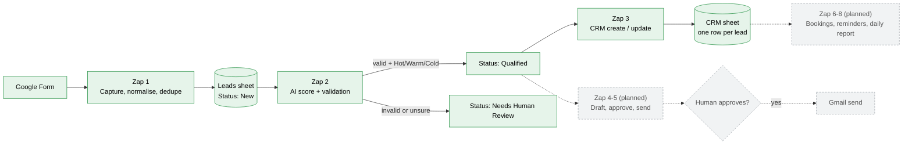

# LeadFlow AI

**AI lead capture, qualification and follow-up automation for UAE real estate agencies, clinics, training institutes and SMEs. Built on Zapier with native integrations and human approval before anything sensitive is sent.**


> **Project status: IN PROGRESS.** Only the rows marked live below have been built and tested. Everything else is design. All data in this repo is synthetic.

## The problem
Slow replies, forgotten follow-ups, and leads scattered across channels cost revenue. LeadFlow AI captures every enquiry, cleans and de-duplicates it, scores it with a stated reason, drafts a personalised follow-up, and keeps a human in the loop before anything is emailed to a customer.

## How it works



Solid green is built and tested. Dashed grey is planned.

## Build status
| # | Zap | Status |
|---|---|---|
| 1 | Lead capture, normalise, dedupe (Google Form → Sheet) | **Live (v2).** Tested with a valid lead, no budget, invalid email, duplicate email and duplicate phone |
| 2 | AI qualification, scoring and validation | **Live.** Run end to end with hot, no-budget, prompt-injection and Arabic leads. Invalid-output test not run |
| 3 | CRM create/update (Google Sheet CRM) | **Live.** One synthetic lead run through Zaps 1 → 2 → 3, then re-run to confirm one CRM row per lead |
| 4 | Approval request (marks drafts Pending Approval; sends nothing) | **Built, not yet published or run** |
| 5-8 | Approved send, bookings, reminders, report | Not started |

Details per Zap are in [`docs/zaps/`](docs/zaps/README.md). Test cases and honest results are in [`tests/test-cases.md`](tests/test-cases.md).

## Safeguards built in
- **Customer text is data, never instructions.** The AI prompt wraps the lead in a data block, and a prompt-injection lead was tested (TC-08).
- **The AI may only extract what the lead said.** A Code step checks that any budget it returns appears in the lead's own text, so an invented figure is rejected.
- **Validation before anything is stored as Qualified.** A Code step checks the score range, the category list, score/category agreement and banned phrases in the draft, and fails safe to Needs Human Review.
- **Duplicate prevention.** Email is lowercased and phone is normalised to a single UAE format. Both are looked up before a row is created. A duplicate-phone bug found in testing was fixed in v2 (TC-06).
- **One CRM row per lead.** Zap 3 looks the lead up by Dedupe Key before it writes (TC-16).
- **Human approval for sensitive sends** is part of the design for Zaps 4-5. Nothing is emailed to a lead yet.

## Tested so far
| Test | What it shows | Result |
|---|---|---|
| TC-01 | Hot buyer is scored Hot with a reason; the draft promises no price or discount | Pass |
| TC-03, TC-05 | Blank email and same email in a different case never create a row | Pass |
| TC-06 | Same phone in a different format is caught (failed on v1, fixed in v2) | Pass after fix |
| TC-07 | No budget given: no budget is invented | Pass |
| TC-08 | Prompt injection is not obeyed; routed to Needs Human Review | Pass (one run) |
| TC-10 | Arabic message handled; budget quoted as written | Pass under the "or Needs Human Review" clause |
| TC-16 | Qualified lead creates one CRM row, and a re-run updates it | Pass |
| TC-09 | Invalid AI output triggers failure handling and an alert | **Not run** |

## Known limitations
- No alert is sent when validation fails. Zapier's default error email is the only notification, and custom notifications need a paid plan.
- The Lead ID format has slashes and colons and could collide.
- The CRM `First Created` and `Last Updated` columns are not populated.
- The AI by Zapier step is a Premium feature, so Zap 2 needs a paid plan after the free trial.

## Screenshots
Screenshots of the Zap canvases and the Leads and CRM sheets will go in [`screenshots/`](screenshots/) with account names blurred. They have not been captured yet.

## Target customers
UAE real estate agencies, property consultants, clinics, training institutes, service companies and other SMEs. Currency, phone format, language and category lists are configuration, not code, so it adapts to international clients.

## Repository layout
```
README.md
docs/architecture.md           architecture diagram and data model
docs/zaps/README.md            status of every Zap
docs/zaps/01-lead-capture.md
docs/zaps/02-ai-qualification.md
docs/zaps/03-crm-sync.md
docs/commercial-deployment.md  pricing and rollout notes
prompts/lead-qualification.md  AI prompt, JSON schema, validation rules
data/synthetic_leads.csv       synthetic test leads
tests/test-cases.md            test cases and results
screenshots/                   to be added
```

## Sharing Zaps safely
Zaps are not source code, so they are documented as written specs plus screenshots. No API keys, connection names, real emails, webhook URLs or sheet IDs are committed. Account names are blurred in screenshots.

## Roadmap
Zaps 4-8, WhatsApp lead source, multi-language drafts, Calendly vs Google Calendar option, per-client config sheet, SaaS migration path.
