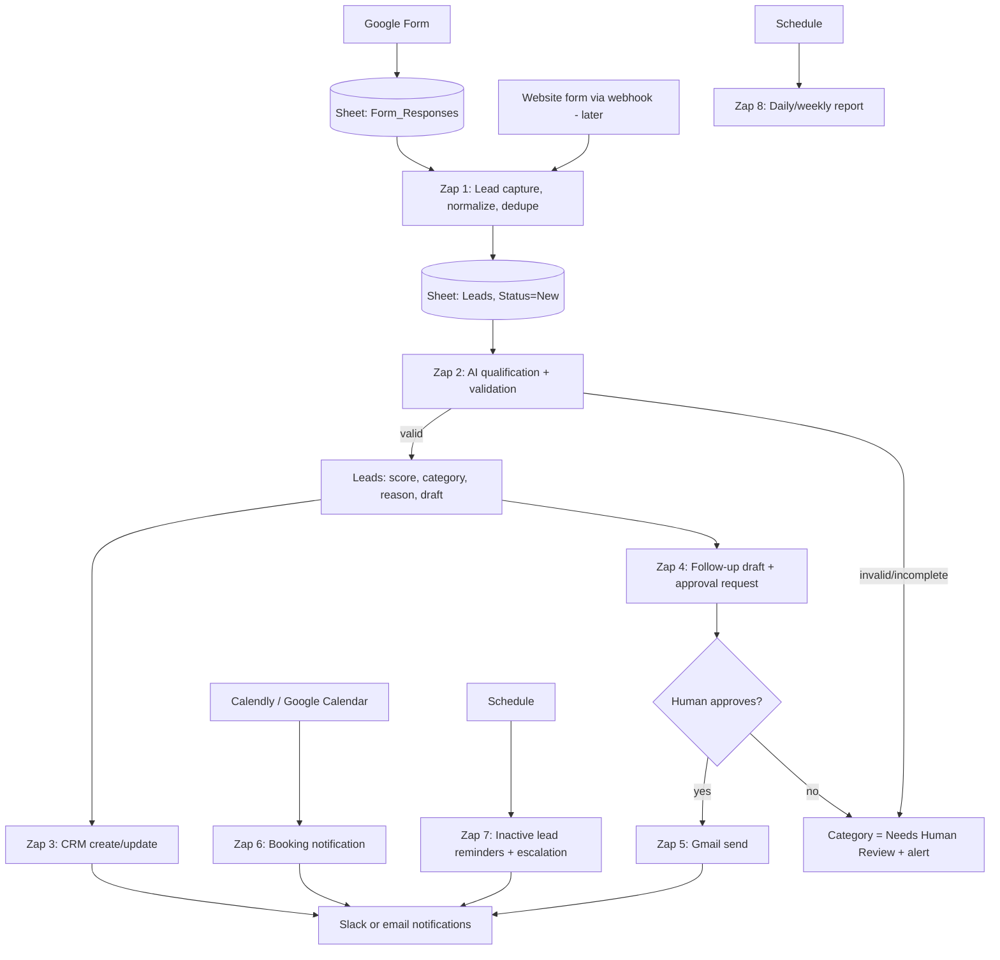

# Architecture

## Data model: sheet `Leads` (single source of truth for the MVP)
| Column | Set by |
|---|---|
| Lead ID, Created At, Source | Zap 1 |
| Full Name, Email (normalized), Phone (normalized), Company | Zap 1 |
| Interest, Budget (raw text), Location, Raw Message | Zap 1 |
| Dedupe Key, Status | Zap 1 (`New`) |
| AI Summary, Requirements, Budget (AI), Urgency, Score, Category, Score Reason, Next Action, Draft Message, Validation Status | Zap 2 |
| CRM ID | Zap 3 |
| Approval Status, Approved By, Sent At | Zap 4/5 |
| Booking Time | Zap 6 |
| Last Contacted, Owner, Escalated | Zap 5/7 |

## Design rules
- Raw customer text is treated as data, never as instructions to the AI.
- The AI may only extract what the lead stated; unknown values are `null`.
- Nothing is emailed to a lead without a recorded human approval.
- Integrations (HubSpot, Calendly, Slack) are used only after verified in the Zap editor; fallback is Google Sheets/Gmail/Google Calendar.
